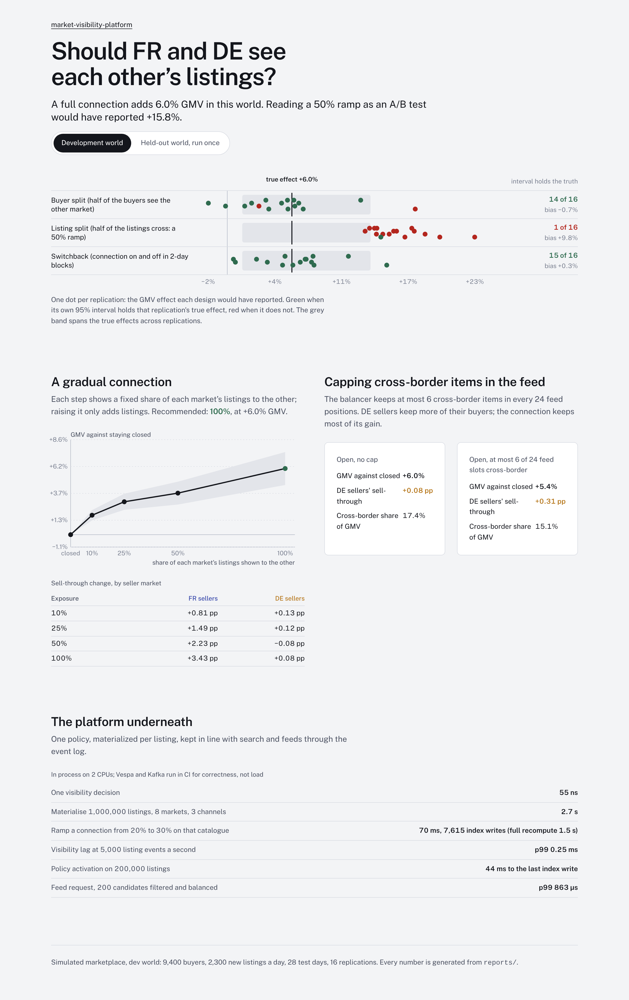

# market-visibility-platform

Cross-border content visibility for a second-hand marketplace. One versioned policy decides which buyer market sees
which seller market's listings, on which channel, and how far a connection has been ramped. A Go service turns that
policy into per-listing visibility, keeps search, feed and similar items in line with it through an event log, and
balances cross-border items inside a feed. A simulated marketplace then asks what connecting two markets does to GMV
and to each side's sell-through, and which experiment design measures that without fooling the team.



## Results

<!-- results:start -->
**Development world**

16 replications; 9400 buyers and 2300 new listings a day across FR and DE; 28 test days after a closed warm-up.

| Exposure of each market to the other | GMV vs closed (95% CI) | Sell-through, FR sellers | Sell-through, DE sellers | Cross-border share of GMV |
|---:|---:|---:|---:|---:|
| 10% | +1.8% (+1.3% to +2.2%) | +0.81 pp | +0.13 pp | 2.9% |
| 25% | +3.0% (+2.2% to +3.7%) | +1.49 pp | +0.12 pp | 6.3% |
| 50% | +3.8% (+2.7% to +4.8%) | +2.23 pp | -0.08 pp | 10.9% |
| 100% | +6.0% (+4.5% to +7.5%) | +3.43 pp | +0.08 pp | 17.4% |
| 100%, feed capped at 6 of 24 | +5.4% (+4.0% to +6.8%) | +3.02 pp | +0.31 pp | 15.1% |

**Which experiment finds the true effect of a full connection (+6.0%)?**

| Design | Bias (points) | RMSE (points) | Its 95% interval holds the truth | Mean interval width |
|---|---:|---:|---:|---:|
| Buyer split (half of the buyers see the other market) | -0.7 | 2.1 | 14 of 16 | 6.8 points |
| Listing split (half of the listings cross: a 50% ramp) | +9.8 | 10.6 | 1 of 16 | 9.8 points |
| Switchback (connection on and off in 2-day blocks) | +0.3 | 1.0 | 15 of 16 | 5.4 points |

**Ramp decision.** Rule as first written (domestic sell-through drop ≤ 1.0 pp): 100%, at +6.0% GMV. Corrected rule (GMV lift above zero at the low end of its interval, and the same sell-through limit): **100%**, at +6.0% GMV.

**Held-out world, first and only run** (more cross-border friction, flatter supply)

16 replications; 9400 buyers and 2300 new listings a day across FR and DE; 28 test days after a closed warm-up.

| Exposure of each market to the other | GMV vs closed (95% CI) | Sell-through, FR sellers | Sell-through, DE sellers | Cross-border share of GMV |
|---:|---:|---:|---:|---:|
| 10% | +0.3% (-0.3% to +0.8%) | +0.10 pp | +0.06 pp | 0.5% |
| 25% | -0.3% (-1.2% to +0.6%) | +0.10 pp | +0.05 pp | 1.2% |
| 50% | -1.8% (-3.0% to -0.7%) | +0.03 pp | -0.39 pp | 2.2% |
| 100% | -2.0% (-3.5% to -0.5%) | +0.07 pp | -0.31 pp | 3.9% |
| 100%, feed capped at 6 of 24 | -1.8% (-3.3% to -0.4%) | +0.10 pp | -0.32 pp | 3.8% |

**Which experiment finds the true effect of a full connection (-2.0%)?**

| Design | Bias (points) | RMSE (points) | Its 95% interval holds the truth | Mean interval width |
|---|---:|---:|---:|---:|
| Buyer split (half of the buyers see the other market) | +0.8 | 1.5 | 15 of 16 | 6.3 points |
| Listing split (half of the listings cross: a 50% ramp) | +7.5 | 8.8 | 2 of 16 | 9.1 points |
| Switchback (connection on and off in 2-day blocks) | +0.4 | 1.2 | 15 of 16 | 5.5 points |

**Ramp decision.** Rule as first written (domestic sell-through drop ≤ 1.0 pp): 100%, at -2.0% GMV. Corrected rule (GMV lift above zero at the low end of its interval, and the same sell-through limit): **stay closed**.

**The platform**

Measured by `go run ./cmd/bench` on 2 CPUs, in process (no network between the pieces).

| What | Result |
|---|---|
| One visibility decision | 55 ns |
| Materialise visibility for 1,000,000 listings, 8 markets, 3 channels | 2.7 s (372842 listings/s) |
| Ramp FR→DE from 20% to 30% on that catalogue | 70 ms incremental vs 1457 ms full recompute; 7615 index writes; 0 mismatches |
| Listing events through the log into the index, backlog | 93484 events/s |
| Visibility lag at 5000 events/s | p50 0.10 ms, p99 0.25 ms |
| Policy activation on 200,000 listings, publish to last index write | 44 ms (4630 partial updates) |
| Feed endpoint, 200 candidates filtered and balanced | p50 485 µs, p99 863 µs |
<!-- results:end -->

## What the numbers say

Numbers below are from `reports/dev.json`, `reports/heldout.json` and `reports/bench.json`; the tables above are
generated from the same files by `go run ./cmd/report`.

1. **Reading a ramp as an A/B test overstates the gain badly.** Comparing the listings that crossed the border with
   the ones that did not (a 50% ramp) put the gain of a full FR–DE connection at +15.8% on average, when the truth
   was +6.0%; its interval held the truth in 1 of 16 replications. In the held-out world all 16 of its estimates were
   gains (+1.7% to +11.9%), while the true effect was a loss in 14 of 16. Cross-border listings sell partly by taking
   buyers from the listings that stayed home, and the comparison books that as new GMV.
2. **A switchback measured it honestly here.** Turning the connection on and off in 2-day blocks was off by +0.3 and
   +0.4 points on average and held the truth in 15 of 16 replications in both worlds, with the narrowest intervals.
   Splitting buyers was close (−0.7 and +0.8 points; 14 and 15 of 16) with wider intervals.
3. **Most of the gain comes early in a ramp.** Showing 10% of each market's listings to the other already gave
   +1.8% GMV, 30% of what the full connection gives (+6.0%). FR sellers' sell-through rose 3.4 points at full
   exposure; DE sellers' did not fall.
4. **The held-out world says do not connect, and caught a hole in my decision rule.** With more cross-border
   friction, the full connection lost 2.0% of GMV. The rule I wrote first only limited the drop in domestic
   sell-through, and it would still have opened the connection. The corrected rule also requires the GMV lift to be
   above zero at the low end of its interval; the held-out report is not re-run, so both answers are shown.
5. **Balancing the feed is a cheap insurance.** Capping cross-border items at 6 of 24 feed slots kept +5.4% of the
   +6.0% and raised DE sellers' sell-through by 0.31 points instead of 0.08.
6. **A ramp step touches a band, not the catalogue.** Moving FR→DE from 20% to 30% on a million listings recomputed
   the 12,273 listings whose bucket lies in the band and sent 7,615 partial updates, in 70 ms instead of a 1.5 s full
   recompute, with zero mismatches against that recompute.

## How it works

```
 decision scientist ──► POST /v1/policies/preview  (what would change, per market pair)
                   ──► POST /v1/policies/activate (validated, versioned in PostgreSQL, published)
                                     │
        listings.v1 ───────┐         ▼ visibility-policies.v1
                           ▼
                 materializer: policy × listing ──► per channel, the buyer markets that may see it
                   │  only the band of buckets a ramp step moves is recomputed
                   ├──► search index (Vespa: partial update of visible_<channel>; in-memory reference)
                   ├──► Redis: masks for request-time checks
                   └──► visibility-changes.v1 (for feed caches and recommendation candidate stores)

 ranking service ──► POST /v1/feed: drop what the policy hides, balance domestic and cross-border per window
 GET /v1/search?market=DE  every query filters on the buyer's market; no channel can forget it
 GET /metrics             Prometheus; SLOs and burn-rate alerts in deploy/prometheus, a Grafana board in deploy/grafana
```

- **Policy** (`internal/policy`): rules per (buyer market, seller market): closed, ramping or open; exposure in basis
  points; a salt that fixes which listings fall inside a ramp, so raising it only adds listings; channels; excluded
  categories; a weight limit for what can ship. `Diff` reports, for two policies, exactly which band of listings can
  change, and a randomized test checks that it never misses one.
- **Materializer and pipeline** (`internal/visibility`): consumes listing and policy events, writes the index and the
  cache, commits only after both, so a crash replays the batch and the replay changes nothing (tested by losing a
  commit on purpose). An invalid policy on the topic is counted and skipped instead of blocking it.
- **Event log** (`internal/stream`): keyed partitions, offsets, consumer groups and lag, in process. The same contract
  runs on Kafka (Redpanda in CI) through `adapters/kafka`, a separate module with franz-go.
- **Search** (`internal/index`): a Vespa application package (`deploy/vespa`) and a client for `/document/v1` and
  YQL; CI deploys it into a Vespa container and runs the same contract as the in-memory index.
- **Feed balancing** (`internal/feed`): merges two ranked lists into k slots with at most and at least a number of
  cross-border items in every window, keeping each list's order; property-tested.
- **Stores** (`internal/store`): PostgreSQL for append-only policy versions, who activated them, and rollback;
  versions are issued under an advisory lock (20 concurrent creates, no duplicates). Redis through a small RESP client.
- **The study** (`internal/market`, `internal/experiment`, `cmd/lab`): sellers in FR and DE list unique items every
  day; buyers browse a ranked feed of what the platform's own policy lets them see; each item sells once, so buyers
  compete. Every replication runs the same world under each design (forks share listings, buyers and random draws).
  The held-out world changes friction and supply, is pinned in `config/heldout.lock`, and runs once.

Design records with the measurements behind them: [docs/decisions.md](docs/decisions.md).

## Limits

- The marketplace is simulated, two markets, at tens of thousands of listings a month. The size of every effect is a
  property of that world; what carries over is the method: forks with shared randomness, designs scored against the
  truth, and a held-out world run once.
- The platform numbers are in process on 2 CPUs. Vespa and Kafka run in CI for correctness, not for load.
- The buyer is a utility model with one purchase per session; returns, messaging, bundles and price offers are out.

## Run it

```bash
go test ./...                          # unit tests; PostgreSQL and Redis tests run when CVP_POSTGRES_DSN / CVP_REDIS_ADDR are set
go run ./cmd/lab                       # the study on the dev world: reports/dev.json (about 90 s on 2 cores)
go run ./cmd/bench                     # reports/bench.json
go run ./cmd/report                    # README results and web/public/data.json
go run ./cmd/cvp -demo 50000           # the API on :8080
cd web && npm ci && npm run dev        # the dashboard
```

The held-out world runs once: `go run ./cmd/lab -world heldout`.

## Layout

```
cmd/cvp            the service: API + pipeline (+ PostgreSQL, Redis, Vespa when configured)
cmd/lab            the market-connection study      cmd/bench   platform measurements      cmd/report   README + dashboard data
internal/policy    rules, ramps, diff               internal/visibility   materializer and pipeline
internal/stream    the event log contract           internal/index        search contract, Vespa client
internal/feed      cross-border balancing           internal/store        PostgreSQL, Redis
internal/api       HTTP                             internal/obs          Prometheus metrics
internal/market    the simulated marketplace        internal/experiment   designs, estimators, scoring
adapters/kafka     stream.Log on Kafka (own module) deploy/               Vespa app, SLO rules, Grafana board
web/               the dashboard (React, Framer Motion, TanStack Query)
```
